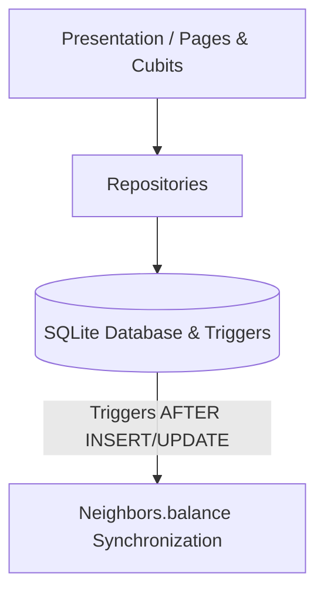

<div align="center">

# 🛡️ Rondón
### **Community Security Shift Management & Volunteer Coordination Platform**

[](https://flutter.dev)
[](https://dart.dev)
[](https://www.sqlite.org)
[](https://clean-code-blog.com/uncle-bobs-clean-architecture-summary/)

*A robust, local-first desktop & mobile application designed to coordinate, schedule, replan, and audit community security patrols and volunteer neighbor shifts.*

</div>

---

## 🌟 Core Features

| Feature | Description |
| :--- | :--- |
| 🔄 **Smart Cycle Generation** | Fair-share scheduling engine respecting rest periods (`min_days_between_shifts`), operational profiles (`ACTIVE`, `SUPPORT`), and gender policies. |
| 👥 **Squad & Neighbor Management** | Complete registry of community members, operational profiles (`ACTIVE`, `SUPPORT`), and base affinities. |
| ⚖️ **Score Ledger (Point Balance)** | Immutable accounting ledger tracking attendance, unexcused absences, voluntary coverages, and administrative adjustments. |
| 🔄 **Intelligent Substitutions** | Automated absence replacement workflow calculating penalty points and prioritizing candidates by debt balance. |
| 📋 **Post-Shift Auditing** | Comprehensive attendance verification interface to close out shifts and update member balances. |

---

## 🏗️ Technical Architecture

Rondon is built using **Pragmatic Clean Architecture** combined with **Cubit** state management and **GetIt** dependency injection.



### Domain Types & Constants (Domain Enums)
- **`Gender`**: `MALE`, `FEMALE`
- **`OperationalProfile`**: `ACTIVE`, `SUPPORT`
- **`AllowedGenderPolicy`**: `FEMALE_ONLY`, `MALE_ONLY`, `MIXED`

---

## 💾 Local Persistence & ACID Triggers

The local SQLite database (`rondon.db`) enforces strict relational integrity:
- **Automated Balance Triggers**: SQLite triggers (`AFTER INSERT`, `AFTER UPDATE`, `AFTER DELETE` on `balance_ledger_records`) automatically compute and update `neighbors.balance`, guaranteeing 100% data consistency.
- **Ledger Protection**: Foreign key constraints (`ON DELETE RESTRICT`) prevent accidental deletion of neighbors with active financial/point history.

---

## 🚀 Getting Started

1. **Clone the repository**:
   ```bash
   git clone https://github.com/your-username/rondon.git
   cd rondon
   ```
2. **Install dependencies**:
   ```bash
   flutter pub get
   ```
3. **Run the application**:
   ```bash
   flutter run
   ```

---

## 🧪 Testing

Rondon features a comprehensive unit and integration test suite:

```bash
flutter test
```
