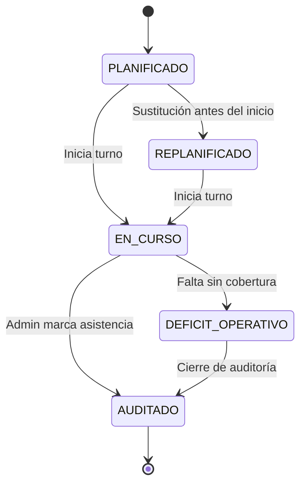

---
tags:
  - domain-rules
  - overview
aliases:
  - System Overview
created: 2026-08-29
---

# 01. Visión General del Sistema y Reglas de Dominio

## 1. Propósito del Sistema
El sistema es una aplicación móvil de gestión local y monopuesto (un único usuario Administrador) diseñada para coordinar, planificar, replanificar y auditar las rondas de guardia de seguridad vecinal.

El objetivo central es garantizar:
1. **Seguridad operativa:** Asegurar que cada turno cuente con la presencia mínima de vecinos físicamente aptos para respuesta rápida.
2. **Equidad distributiva (Fair-Share):** Distribuir la carga de guardias de manera homogénea y llevar un control estricto de deudas/créditos de turnos cuando ocurren inasistencias o coberturas.
3. **Preservación de afinidad:** Mantener estables los grupos familiares/amicales (cuadrillas) aun cuando ocurran sustituciones temporales.

---

## 2. Arquitectura de Dominio y Terminología

### 2.1. Entidades del Dominio

*   **Vecino (Neighbor):** Individuo registrado que participa en las guardias.
*   **Perfil Operativo (OperationalProfile):**
    *   `ACTIVO`: Vecino con plena capacidad física y de movilidad para patrullaje y respuesta inmediata.
    *   `APOYO`: Vecino con limitaciones físicas leves, personas mayores, o cualquier participante que requiera acompañamiento.
*   **Género Operativo (Gender):** `MASCULINO`, `FEMENINO` (utilizado para satisfacer restricciones de configuración de turnos).
*   **Plantilla de Turno (ShiftTemplate):** Definición abstracta y reutilizable de una franja horaria dentro de una noche (ej. Turno 1: 22:00 a 02:00, Turno 2: 02:00 a 06:00).
*   **Cuadrilla Base (BaseSquad):** Grupo de afinidad compuesto por vecinos que habitualmente realizan guardias juntos.
*   **Guardia Programada (ScheduledShift):** Instancia concreta de un turno en una fecha determinada.
*   **Asignación de Guardia (ShiftAssignment):** Vínculo entre un vecino y una guardia programada, con indicación de su rol (Titular o Sustituto) y su estado de cumplimiento.

---

## 3. Invariantes y Reglas de Negocio Estrictas

> [!RULE] Regla 1: Restricciones de Género por Turno y Excepción Operativa
> 1. Cada plantilla de turno define su política de género: `SOLO_MUJERES`, `SOLO_HOMBRES` o `MIXTO`.
> 2. **Invariante de Excepción:** Si una mujer participa en un turno categorizado como `SOLO_HOMBRES` (ej. turno de madrugada por falta de efectivos o voluntariado), el sistema la computará automáticamente con perfil operativo `APOYO` dentro de ese turno específico para salvaguardar la regla de composición física.

> [!CAUTION] Regla 2: Matriz de Seguridad y Capacidad Operativa (`min_activos`)
> Ningún turno puede quedar compuesto exclusivamente por perfiles de `APOYO`.
> *   Para turnos de **2 personas**: Mínimo **1 ACTIVO** requerido.
> *   Para turnos de **3 a 4 personas**: Mínimo **1 ACTIVO** requerido (configurable a 2).
> *   Si una sustitución propuesta viola este mínimo, el sistema debe emitir una advertencia de seguridad bloqueante o requerir confirmación explícita del Administrador.

> [!IMPORTANT] Regla 3: Política de Descanso Obligatorio (Separación Mínima)
> Para evitar agotamiento y sobrecarga:
> *   Un vecino no puede tener dos asignaciones en días consecutivos ($Fecha_N$ y $Fecha_{N+1}$).
> *   Un vecino no puede tener dos asignaciones en días alternos ($Fecha_N$ y $Fecha_{N+2}$).
> *   **Invariante Temporal:** El intervalo mínimo de separación entre el fin de una guardia y el inicio de la siguiente para el mismo vecino debe ser $\ge DíasMinimosDescanso$ (Valor por defecto: **3 días completos libres**).

> [!ABSTRACT] Regla 4: Sistema de Balance y Puntuación de Equidad (Score Ledger)
> El balance de guardia ($B_v$) de un vecino $v$ es un acumulador de enteros:
> *   $B_v = 0$: El vecino está al día con sus compromisos comunitarios.
> *   $B_v > 0$ (Crédito): El vecino ha cubierto a otros o realizado turnos adicionales. Tiene baja prioridad de asignación en rotaciones forzadas.
> *   $B_v < 0$ (Deuda): El vecino ha faltado a guardias o tiene turnos pendientes por pagar. Tiene **máxima prioridad** para ser asignado en huecos disponibles.
> 
> #### Eventos de Afectación de Balance:
> 1. **Falta no cubierta / Inasistencia:** Se decrementa el balance del vecino ausente ($B_{ausente} \leftarrow B_{ausente} - 1$).
> 2. **Cobertura por Sustituto:** El vecino que acude a cubrir recibe un incremento ($B_{sustituto} \leftarrow B_{sustituto} + 1$).
> 3. **Turno de Recuperación (Liquidación de Deuda):** Cuando un vecino con $B_v < 0$ es asignado a un hueco y cumple la guardia, su balance incrementa ($B_v \leftarrow B_v + 1$), acercándose a 0.

> [!INFO] Regla 5: Desacoplamiento de Cuadrilla Base y Asignación Real
> *   La inasistencia de un miembro **NO** altera la composición de su `CuadrillaBase`.
> *   La sustitución se registra a nivel de `ShiftAssignment` con bandera `is_substitute = true`.
> *   Cuando el deudor recupera su turno en otra fecha, lo hace en calidad de sustituto/refuerzo externo; al llegar la siguiente rotación habitual de su cuadrilla original, regresa automáticamente con su grupo base.

> [!WARNING] Regla 6: Tolerancia a Déficit de Personal (Under-Quota)
> Si un vecino causa baja y no existe un candidato compatible disponible o el Administrador decide no sustituirlo:
> *   La guardia se marca en estado `DEFICIT_OPERATIVO` (se ejecuta con $Cupo - 1$).
> *   El vecino ausente mantiene su penalización ($B_{ausente} \leftarrow B_{ausente} - 1$).
> *   El turno procede con los miembros restantes si se cumple la [[01_SYSTEM_OVERVIEW_AND_DOMAIN_RULES#Regla 2: Matriz de Seguridad y Capacidad Operativa (min_activos)|Regla 2]] (al menos 1 ACTIVO).

---

## 4. Estado de los Turnos y Flujo de Vida

1. **Planificado:** Generado por el ciclo automático o asignado manualmente. Ver [[03_BUSINESS_LOGIC_AND_ALGORITHMS#3. Algoritmo de Generación de Calendario Cíclico|Algoritmo de Generación]].
2. **Replanificado:** Ha sufrido cambios en sus participantes titulares (sustituciones registradas).
3. **Auditado/Cerrado:** Estado terminal. El Administrador valida la asistencia real. En este momento se impactan definitivamente los balances en la [[02_DATA_MODEL_AND_SQLITE_SCHEMA#7. Historial / Auditoría de Puntuación y Balances (Score Ledger)|Base de Datos]].

---

Ver también:
- [[02_DATA_MODEL_AND_SQLITE_SCHEMA|Modelo de Datos y Esquema SQLite]]
- [[03_BUSINESS_LOGIC_AND_ALGORITHMS|Lógica de Negocio y Algoritmos]]
