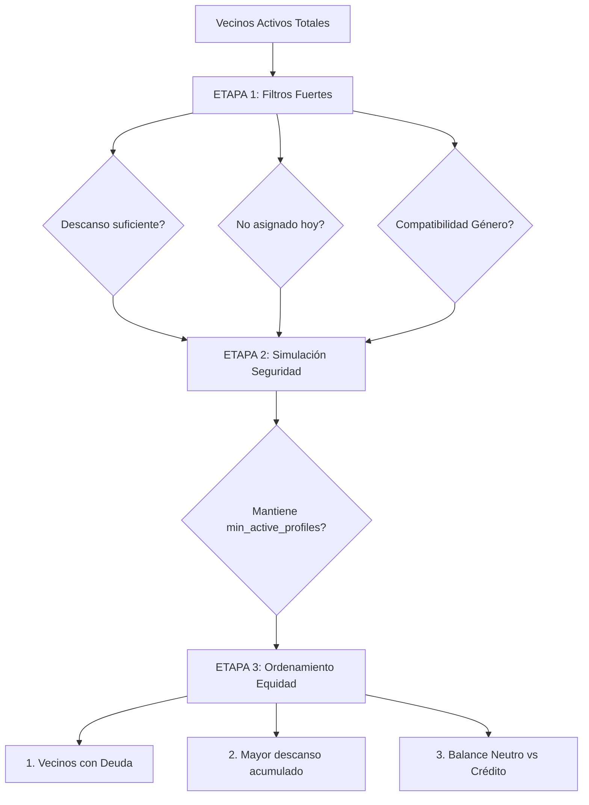
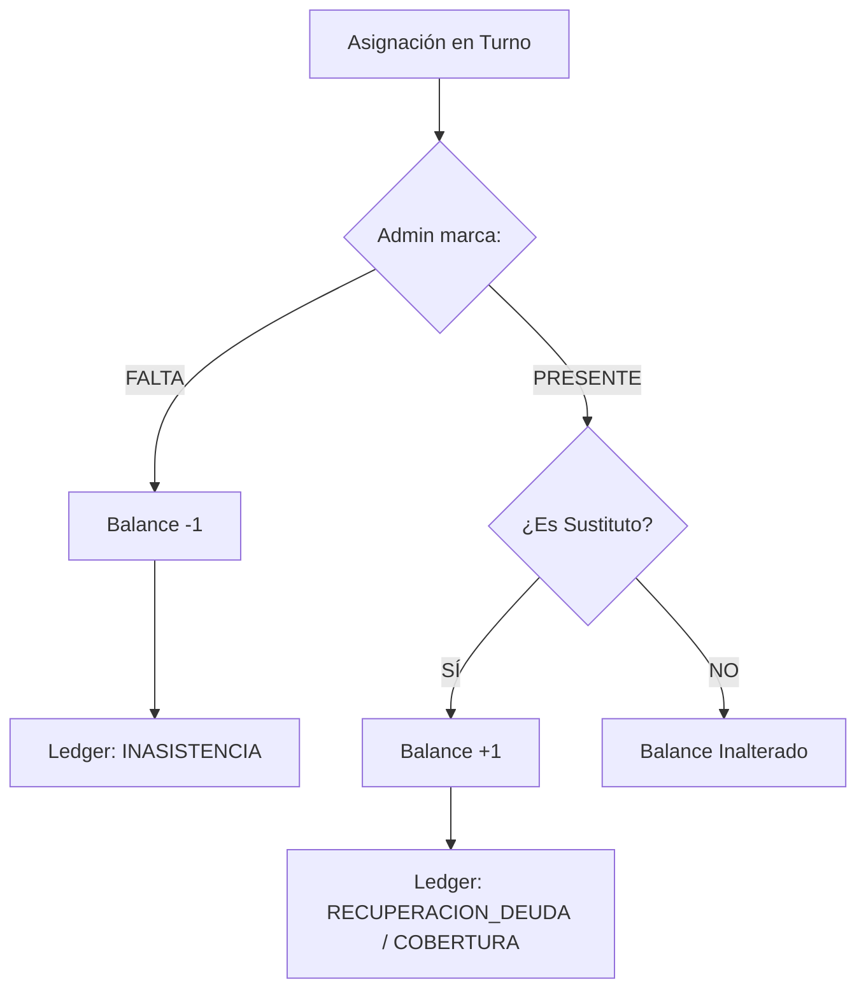

---
tags:
  - business-logic
  - algorithms
  - substitution-engine
created: 2026-08-29
---

# 03. Lógica de Negocio y Algoritmos del Dominio

## 1. Validación de Periodos de Descanso (Rest-Period Invariant)

Para evitar la sobrecarga y el agotamiento de los vecinos, ninguna asignación (sea planificada, sustitución o recuperación de deuda) puede violar la ventana de descanso configurada.

### 1.1. Definición Matemática
Sea $T$ la fecha objetivo (`targetDate`) de la guardia a asignar, y sea $D_{min}$ el parámetro global `min_days_between_shifts` (por defecto $3$ días).

Un vecino $v$ es **temporalmente elegible** si y solo si:
$$\forall s \in \text{Asignaciones}(v): |\text{Fecha}(s) - T| > D_{min}$$

Esto garantiza automáticamente que:
1. No haya guardias en días consecutivos ($|T_1 - T_2| \ne 1$).
2. No haya guardias en días alternos ($|T_1 - T_2| \ne 2$).
3. Exista un búfer de al menos $D_{min}$ días completos libres antes y después de la fecha objetivo.

---

## 2. Motor de Clasificación y Búsqueda de Candidatos (Substitution Engine)

Cuando un vecino titular causa baja o se necesita un refuerzo, el sistema evalúa a todos los vecinos activos del sistema aplicando un filtro de tres etapas: **Elegibilidad Fuerte**, **Regla de Seguridad** y **Ordenamiento por Equidad**.



### 2.1. Resolución del Perfil Operativo Efectivo
Antes de validar la seguridad del turno, se calcula el `effective_operational_profile` del candidato en ese turno específico:

> [!RULE] Lógica de Excepción por Género
> SI `Plantilla.allowed_gender == 'SOLO_HOMBRES'` Y `Candidato.gender == 'FEMENINO'` ENTONCES:
>    `effective_profile = OperationalProfile.APOYO`
> SINO:
>    `effective_profile = Candidato.operational_profile`

### 2.2. Función de Puntuación para Ordenamiento (Sorting Comparator)

Para ordenar los candidatos elegibles de forma determinista y justa:

```dart
int compareCandidates(
  NeighborCandidate a,
  NeighborCandidate b,
  DateTime targetDate,
) {
  // CRITERIO 1: Saldo de guardias (Los deudores van primero para pagar)
  if (a.neighbor.balance != b.neighbor.balance) {
    return a.neighbor.balance.compareTo(b.neighbor.balance);
  }

  // CRITERIO 2: Días desde la última guardia realizada (Mayor tiempo de descanso va primero)
  final daysSinceLastA = a.lastShiftDate != null 
      ? targetDate.difference(a.lastShiftDate!).inDays 
      : 9999; 
  final daysSinceLastB = b.lastShiftDate != null 
      ? targetDate.difference(b.lastShiftDate!).inDays 
      : 9999;

  if (daysSinceLastA != daysSinceLastB) {
    return daysSinceLastB.compareTo(daysSinceLastA); 
  }

  // CRITERIO 3: Desempate por orden alfabético
  return a.neighbor.fullName.compareTo(b.neighbor.fullName);
}
```

---

## 3. Algoritmo de Generación de Calendario Cíclico

El Administrador puede generar la planificación para un rango de fechas (ej. 1 mes / 30 días). El algoritmo combina la rotación de **Cuadrillas Base** con la **inyección de deudores** en vacantes.

### 3.1. Procedimiento Paso a Paso

1. **Definir Rango:** Desde `startDate` hasta `endDate`.
2. **Iterar por cada Día ($D$):**
   * Por cada `ShiftTemplate` activa:
     1. Crear instancia `ScheduledShift` con estado `PLANIFICADO`.
     2. **Asignación de Cuadrilla Base:**
        * Buscar la siguiente `BaseSquad` en el turno rotativo asociada a esta plantilla.
        * Si cumple el descanso de sus miembros: Asignar como titulares.
     3. **Cobertura de Vacantes:**
        * Calcular vacantes: $V = \text{target\_quota} - \text{Asignados}$.
        * Si $V > 0$: Invocar al Substitution Engine para candidatos con deuda.
     4. **Verificación de Seguridad:**
        * Si $\text{Activos} < \text{min\_active\_profiles}$: Reemplazar miembros `APOYO` por `ACTIVO` elegibles.

---

## 4. Máquina de Estados del Ledger y Mutaciones de Balance



### 4.1. Reglas Atómicas de Transición

#### Caso A: Sustitución en Tiempo Real (Replanificación)
1. Vecino Original $V_O$ declara baja.
2. Administrador selecciona Sustituto $V_S$.
3. **Impacto:** $V_O$ recibe `delta = -1` inmediatamente. $V_S$ recibe `delta = +1` solo tras la auditoría exitosa.

#### Caso B: Auditoría Post-Guardia
1. Titular no asistió sin aviso: `delta = -1` (Razón: `INASISTENCIA`).
2. Sustituto asistió: `delta = +1` (Razón: `RECUPERACION_DEUDA` o `COBERTURA_VOLUNTARIA`).

---

## 5. Casos de Borde y Políticas de Excepción

| Escenario | Comportamiento del Sistema |
| :--- | :--- |
| **No hay candidatos** | Permite confirmar con `DEFICIT_OPERATIVO`. Penaliza al ausente. |
| **Cuadrilla incompleta** | El algoritmo llena cupos con deudores o vecinos más descansados. |
| **Conflicto de seguridad** | Bloquea autocompletado; exige selección manual de un `ACTIVO`. |
| **Mujer en turno hombres** | Permite asignación pero fuerza perfil `APOYO`. |
