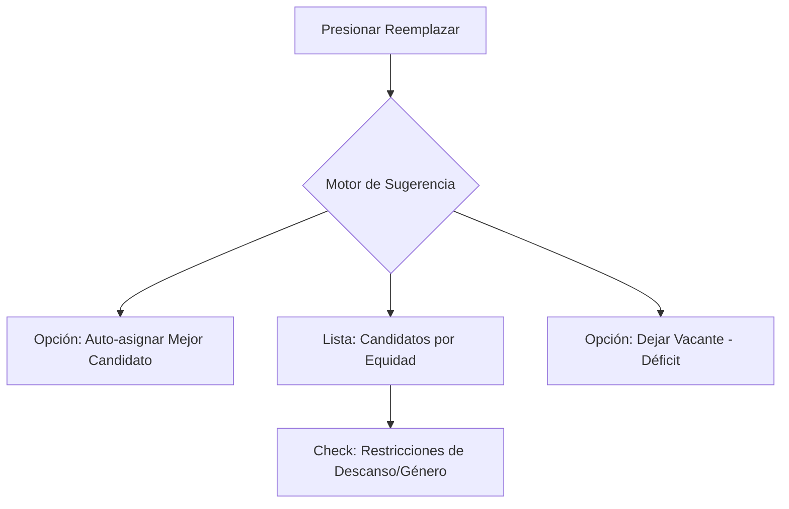

---
tags:
  - ui-ux
  - interface
  - navigation
created: 2026-08-29
---

# 04. Interfaz de Usuario y Flujos de Experiencia (UX/UI)

## 1. Arquitectura de Navegación

La aplicación utiliza una `BottomNavigationBar` con 4 pilares fundamentales:

---

## 2. Definición Detallada de Pantallas

### 2.1. Pantalla 1: Dashboard / Vista de Hoy (`HomeScreen`)
Es el centro de control rápido donde el Administrador atiende las tareas inmediatas.

> [!TIP] Componentes Clave:
> - **Banner de Auditoría Pendiente:** Aparece si hay turnos de anoche sin cerrar.
> - **Tarjetas de Turno:** Semáforo de seguridad (`min_activos`) y gestión de miembros.
> - **Acción Rápida:** Acceso directo a WhatsApp y modales de reemplazo.

### 2.2. Pantalla 2: Calendario y Planificación (`CalendarScreen`)
Vista mensual con indicadores de estado por día (puntos de color).

- **Acción Principal:** "Generar Mes". Dispara el [[03_BUSINESS_LOGIC_AND_ALGORITHMS#3. Algoritmo de Generación de Calendario Cíclico|Algoritmo de Generación]].

### 2.3. Modal / Hoja de Replanificación (`ReplacementBottomSheet`)
Se dispara al presionar "Reemplazar" sobre un vecino.

### 2.4. Pantalla 3: Flujo de Auditoría de Asistencia (`AuditShiftScreen`)
Cierre formal de los turnos para impactar los balances.

> [!IMPORTANT] Auditoría Atómica
> Al confirmar la asistencia, se ejecutan las mutaciones de balance detalladas en la [[03_BUSINESS_LOGIC_AND_ALGORITHMS#4. Máquina de Estados del Ledger y Mutaciones de Balance|Máquina de Estados]].

### 2.5. Pantalla 4: Directorio de Vecinos y Cuadrillas (`NeighborsDirectoryScreen`)
Gestión de la base social del sistema.

- **Pestaña Vecinos:** Balance visual mediante chips de color (Rojo: Deuda, Gris: Al día, Verde: Crédito).
- **Pestaña Cuadrillas:** Agrupaciones por afinidad.

---

## 3. Estados Visuales de Turnos

| Estado | Indicador Visual | Acción Requerida |
| :--- | :--- | :--- |
| **Planificado** | Azul / Neutro | Notificar por WhatsApp |
| **Defecto Cupo** | Naranja | Buscar sustitutos |
| **Inseguro** | Rojo Parpadeante | Asignar perfil ACTIVO obligatorio |
| **Auditado** | Check Verde | Ninguna (histórico) |
